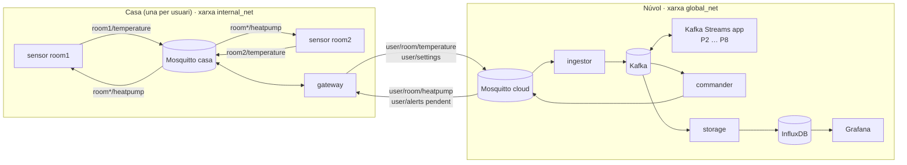
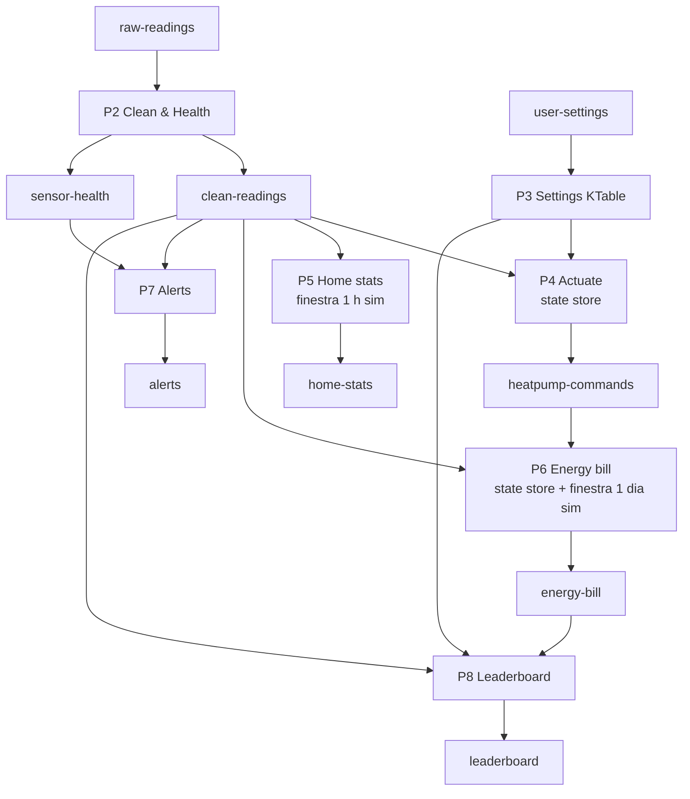

# Arquitectura del Project 01 · Plataforma IoT de confort

Aquest document explica **com ha de funcionar el sistema sencer**: les peces que ja funcionen i les que encara falten. Serveix perquè tots dos tinguem el mateix mapa mentre treballem cadascú a la seva branca.

Llegenda d'estat: ✅ fet i provat · 🟡 fet, falta provar · ⬜ pendent · 📝 proposta encara no pactada

---

## 1. La idea en 30 segons

Cada casa té sensors de temperatura (un per habitació) i un **gateway**. El gateway envia les lectures al **núvol** per MQTT. Al núvol:

1. L'**ingestor** les passa a **Kafka**.
2. Una única aplicació **Kafka Streams** les neteja, n'extreu estadístiques i decideix quan s'ha d'encendre o apagar la bomba de calor de cada habitació.
3. El **commander** fa arribar aquestes ordres a les cases, i l'**storage** ho desa tot a **InfluxDB** perquè es pugui veure a **Grafana**.

Escala del temps: **1 segon real = 1 minut simulat**. Cada lectura representa un minut de la casa.

---

## 2. Diagrama general



**Les dues xarxes Docker:**
- `internal_net`: privada de cada casa. Només hi ha els sensors, el Mosquitto de casa i el gateway.
- `global_net`: fa d'"Internet". Hi ha tots els gateways i tot el núvol. El **gateway és l'única peça que és a totes dues**.

---

## 3. Components

| Component | On és | Tecnologia | Què fa | Responsable | Estat |
|---|---|---|---|---|---|
| Sensor | `user/user/sensor_temperature/` | Python (donat) | Publica una lectura cada segon i escolta ordres de la bomba. **No es pot modificar** | donat | ✅ |
| Mosquitto casa | `user/user/home*.yml` | eclipse-mosquitto 1.6.12 | Broker MQTT privat de la casa (sense ports oberts al host) | Agus | ✅ |
| Gateway | `user/user/gateway/` | Python + paho-mqtt | Pont casa ↔ núvol. Afegeix `user`/`room`, reenvia settings i valida les ordres | Agus | ✅ |
| Mosquitto cloud | `cloud/` | eclipse-mosquitto 1.6.12 | Broker MQTT públic del núvol | Clara | ✅ (al compose de prova) |
| Ingestor | `cloud/ingestor/` | Python + paho + confluent-kafka | MQTT → Kafka (`raw-readings`, `user-settings`) amb clau | Agus | ✅ |
| Kafka | `cloud/` | apache/kafka 3.8 (KRaft) | Bus de missatges, 3 particions per topic | Clara | ✅ (al compose de prova) |
| Storage | `cloud/` | Telegraf o consumidor propi | Kafka → InfluxDB | Clara | ⬜ #2 |
| Kafka Streams app | `cloud/` | Java (una sola app i topologia) | Pipelines P2–P8 | Clara + Agus | ⬜ #4 |
| Commander | `cloud/` | Python | Kafka (`heatpump-commands`, `alerts`) → MQTT del cloud | Agus | ⬜ |
| InfluxDB + Grafana | `cloud/` | — | Emmagatzematge i dashboards | Clara (compose) + Agus (dashboards) | ⬜ #1 |

---

## 4. Contractes: topics, claus i formats

Aquesta és la part que **tots dos hem de respectar** perquè les peces encaixin. Si algú ho vol canviar, s'ha de pactar abans.

### 4.1 MQTT

| Broker | Topic | Qui publica → qui escolta | Contingut |
|---|---|---|---|
| casa | `<room>/temperature` | sensor → gateway | `{"timestamp": "2026-11-25T10:00:00.123456", "value": 21.4}` |
| casa | `<room>/heatpump` | gateway → sensor | `{"status": 1}` o `{"status": 0}` |
| casa | `settings` | usuari (`mosquitto_pub`) → gateway | `{"mode": "comfort", "min": 21, "max": 24}` |
| cloud | `<user>/<room>/temperature` | gateway → ingestor | lectura + `"user"` i `"room"` |
| cloud | `<user>/settings` | gateway → ingestor | settings tal com arriben |
| cloud | `<user>/<room>/heatpump` | commander → gateway | `{"status": 0\|1}` (fixat al codi del gateway) |
| cloud | `<user>/alerts` | commander → gateway | alerta en JSON 📝 · ⬜ el gateway encara no s'hi subscriu (l'enunciat demana que les alertes arribin a casa) |

El format de `settings` surt de l'exemple de l'enunciat (P3).

### 4.2 Kafka

Tots els topics tenen **3 particions**. La **clau** decideix la partició: `hash(clau) mod 3`.

| Topic | Clau | Valor | Escriu | Llegeix | Notes |
|---|---|---|---|---|---|
| `raw-readings` | `<user>/<room>` | lectura tal com arriba (també les mal formades) | ingestor | P2, storage | ✅ provat de punta a punta (mal formades: només test unitari) |
| `user-settings` | `<user>` | `{"mode", "min"?, "max"?}` | ingestor | P3 (KTable) | ✅ arriben amb clau `<user>` · ⬜ **compactat** (#1) |
| `clean-readings` | `<user>/<room>` | lectura sense els valors de 100 | P2 | P4, P5, P6, P7, storage | |
| `sensor-health` 📝 | `<user>/<room>` | errors per dia simulat | P2 | P7, storage | |
| `heatpump-commands` | `<user>/<room>` | `{"status": 0\|1}` | P4 | commander, P6 | 📝 format Kafka a pactar a #7 |
| `home-stats` | `<user>` | mitjana/mín/màx per hora simulada | P5 | storage | |
| `energy-bill` | `<user>` | minuts encesa, kWh i € per dia simulat | P6 | P8, storage | |
| `alerts` | `<user>` | tipus + habitació + detall | P2/P7 | commander, storage | 📝 #7 |
| `leaderboard` | una clau única 📝 | rànquing per cost i per confort | P8 | storage | |

### 4.3 Per què aquestes claus

- **`<user>/<room>` a les lectures:** Kafka només garanteix l'ordre dins d'una partició. Amb aquesta clau, totes les lectures d'una habitació van a la mateixa partició i en ordre. És el que necessiten l'estat de la bomba (P4), el recompte d'errors (P2) i la detecció de sensor mort (P7). A més, les habitacions es reparteixen entre les particions i, per tant, entre les tasques.
- **`<user>` als settings i a les agregacions per casa:** la configuració, les estadístiques i la factura són per usuari.
- **Canviar de clau té un cost:** passar de `<user>/<room>` a `<user>` (P4, P5, P6) crea un **repartition topic** intern i, per tant, una sub-topologia nova. Els joins ho necessiten, perquè els dos costats han d'estar **co-particionats**.

---

## 5. Les pipelines (una sola app Kafka Streams)

Totes les pipelines viuen en **un sol `application.id`** i **una sola topologia**. L'única excepció és la P1, que no fa servir Kafka Streams.



| Pipeline | Entrada | Què fa | Sortida | Estat (state store / finestra) | Responsable |
|---|---|---|---|---|---|
| **P1** Save raw | `raw-readings` | La guarda tal qual a InfluxDB (la fa l'storage, sense Streams) | InfluxDB | — | Clara |
| **P2** Clean & health | `raw-readings` | Llença els valors d'exactament 100 i els missatges mal formats **sense parar l'app**; compta els errors per sensor i per dia simulat | `clean-readings`, `sensor-health` | finestra d'1 dia simulat (event time) | Agus |
| **P3** Settings | `user-settings` | KTable amb els últims settings de cada usuari. Modes: comfort (per defecte 20–25), eco 17–20, away = bomba apagada excepte si la temperatura < 12 °C | (KTable interna) | KTable | Clara |
| **P4** Actuate | `clean-readings` + P3 | Canvia la clau a `user` → **leftJoin** (un usuari sense settings fa servir comfort 20–25) → decideix on/off. **Només emet quan l'estat canvia**. Un canvi de mode s'aplica a la lectura següent, sense reiniciar res | `heatpump-commands` | store on/off per `user/room` | Clara |
| **P5** Home stats | `clean-readings` | Canvia la clau a `user` i calcula mitjana, mín i màx de tota la casa | `home-stats` | finestra d'1 hora simulada (event time) | Agus |
| **P6** Energy bill | `heatpump-commands` + `clean-readings` | Desa a un state store l'últim estat de cada bomba (les ordres només arriben quan canvia) i compta 1 minut encès per cada lectura amb la bomba encesa → × 2 kW → kWh → € segons la franja horària simulada | `energy-bill` | store d'estat per `user/room` + finestra d'1 dia simulat | Agus |
| **P7** Alerts | `raw-readings` (sensor mort), `clean-readings` (fora de rang), `sensor-health` | Sensor mort (> 1 min real sense cap missatge: un sensor que envia 100 no està mort), fora de rang (< 12 o > 30), necessita manteniment | `alerts` | darrer missatge per habitació + punctuator `WALL_CLOCK_TIME` (si el sensor calla, l'event time no avança) | Agus |
| **P8** Leaderboard | `energy-bill`, `clean-readings` + settings (P3) | Rànquing diari per cost i per % de minuts dins del rang de confort (cal el min/max de cada usuari) | `leaderboard` | ajunta **tots** els usuaris en una sola clau → coll d'ampolla d'escalabilitat (s'ha d'explicar a l'informe) | Clara |

**Temps:** les finestres fan servir l'**event time** del `timestamp` del JSON, que es llegeix amb un `TimestampExtractor` propi. Aquest `timestamp` **ja és temps simulat**: el sensor calcula `inici + (ara − inici) × 60`. Per tant, les finestres es defineixen en temps simulat (1 h, 1 dia), no en minuts reals. Cal tenir en compte:
- Quan els microsegons són 0, el `timestamp` ve **sense decimals**.
- Els missatges mal formats **no en tenen**, i l'extractor ha de tornar un valor per defecte.
- **Cada sensor té el seu propi rellotge**, que comença quan arrenca el sensor. Dos sensors que arrenquin amb 1 s de diferència van ~1 hora simulada desfasats.
- Si un sensor es reinicia, el seu temps torna enrere i les seves lectures arriben "tard". Això afecta el `grace` de les finestres de P5/P6 i la franja horària de la tarifa de la P6.

**Tarifa (P6):** nit (00–08 h) 0,10 €/kWh · dia (08–18 h i 22–24 h) 0,15 €/kWh · punta (18–22 h) 0,25 €/kWh.

---

## 6. Recorregut d'una lectura, pas a pas

1. El **sensor** de `room1` de l'`user1` publica `{"timestamp": "...", "value": 16.5}` a `room1/temperature` del Mosquitto de casa.
2. El **gateway** la rep (`+/temperature`), hi afegeix `"user": "user1", "room": "room1"` i la publica al cloud a `user1/room1/temperature` (QoS 1).
3. L'**ingestor** la rep i la publica a Kafka, a `raw-readings`, amb la clau `user1/room1`.
4. L'**storage** la desa tal qual a InfluxDB (P1).
5. La **P2** comprova que no valgui 100 i l'envia a `clean-readings`.
6. La **P4** canvia la clau a `user1`, la uneix amb els settings (`comfort 21–24`) i veu que 16,5 < 21 → si la bomba estava apagada, emet `{"status": 1}` a `heatpump-commands` amb la clau `user1/room1`.
7. El **commander** ho llegeix i ho publica al MQTT del cloud a `user1/room1/heatpump`.
8. El **gateway** valida l'ordre i la passa a casa, a `room1/heatpump`. El sensor encén la bomba i la temperatura comença a pujar (✅ això ja ho hem comprovat enviant l'ordre a mà).

---

## 7. Com es fa funcionar

```bash
docker network create global_net                                              # un sol cop
docker compose -f cloud/docker-compose.test.yml --project-name cloud up -d --build   # núvol (de prova)
docker compose -f user/user/home1.yml --project-name user1 up -d --build      # casa 1
docker compose -f user/user/home2.yml --project-name user2 up -d --build      # casa 2
```

Comprovacions:
- Veure els contenidors: `docker ps` o la pestanya **Containers** de Docker Desktop (agrupats per `cloud`, `user1`, `user2`).
- Seguir les lectures: `docker logs -f user1-gateway-1` i `docker logs -f cloud-ingestor-1`.
- Kafka: `docker exec -it cloud-kafka-1 /opt/kafka/bin/kafka-console-consumer.sh --bootstrap-server localhost:9092 --topic raw-readings --property print.key=true`

> El `docker-compose.test.yml` és provisional. Quan el compose definitiu del cloud estigui fet (#1), aquesta secció s'ha d'actualitzar.

---

## 8. Com treballem

- **Branques:** cadascú treballa a la seva (`agus`, `clara`). `main` està protegida: només s'hi entra amb una pull request **aprovada per l'altra persona**.
- **Després de cada merge:** `git pull origin main` a la teva branca.
- **Finals de línia:** el `.gitattributes` obliga a fer servir LF a tots dos sistemes (Windows i Linux).
- **Contractes:** qualsevol canvi a la secció 4 es pacta abans en un issue.
- **Tasques:** a GitHub Issues. Les de la Clara són #1–#6; el format de `heatpump-commands` i `alerts` es pacta a #7.
